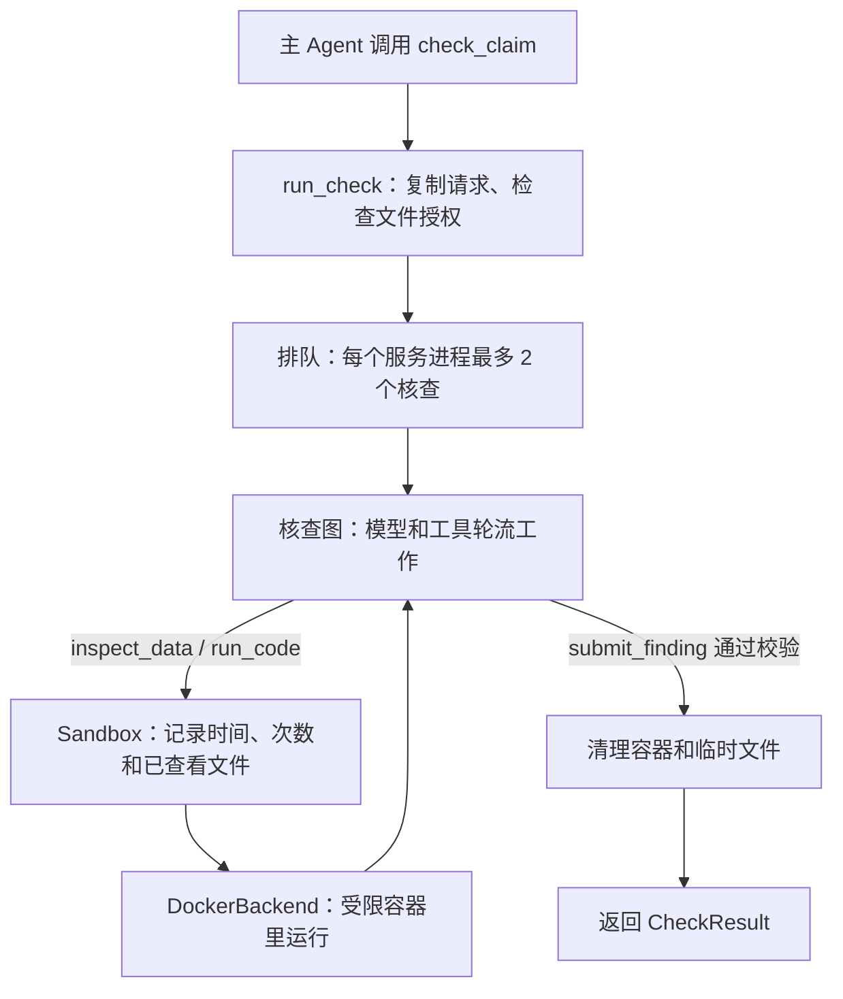

# Coding 计算核查子 Agent 交接说明

更新日期：2026-10-20。代码在 `feat/computational-check-agent` 分支，位于 `app/agent/coding/`、`sandbox/` 和 `tests/test_coding.py`。需求、接口字段和验收标准的完整定义见 `coding-spec.md`。

## 它做什么

主 Agent 交来一句需要计算的话（claim）和本次审核授权的 CSV/JSON 附件。子 Agent 让模型查看数据、写 Python，在隔离容器里完整运行计算，最后返回结论、证据和全部运行记录。

- 结论 `verdict` 针对交来的那句话：`supports`、`refutes` 或 `inconclusive`。
- 子 Agent 不面对用户，不创建或批准 flag，不使用外部知识。缺单位、期间或口径时返回 `inconclusive`。

## 调用流程



1. `run_check` 在第一次等待之前复制并重新校验请求，检查每个文件编号都已授权、文件不超过 10 MiB、路径上没有链接。不合规时直接抛出 `ValidationError` 或 `ValueError`。
2. 拿到并发名额后进入核查图。60 秒预算从调用开始计算，排队时间也算在内。
3. 模型可以调用 3 个工具：
   - `inspect_data`：查看文件格式和前 5 条样本。
   - `run_code`：在新的 Python 进程里运行完整代码，最多 3 次。
   - `submit_finding`：交结论，必须是这次回复里唯一的调用。
4. 模型能改正的错误（参数不对、证据引用了没看过的文件、没有成功运行就给出支持或反驳）作为工具错误退回模型。改不了的错误（超时、预算用完、数据格式不对、Docker 故障）结束核查，并以错误码的形式返回。
5. 无论成功、失败、超时还是取消，都会删除容器和临时文件，之后才归还名额。

## 模块分工

| 文件 | 职责 |
| --- | --- |
| `limits.py` | 全部限额，只在这里定义 |
| `schemas.py` | 输入输出字段、错误码，以及结果一致性校验 |
| `agent.py` | 入口 `run_check`：排队、超时、错误转换、清理、日志 |
| `graph.py` | 系统提示词、核查图、`submit_finding` 校验 |
| `tools.py` | 模型看到的 3 个工具定义 |
| `sandbox.py` | 单次核查的时间和次数记录，`ExecutionBackend` 接口 |
| `staging.py` | 文件授权检查、复制副本、安全删除 |
| `docker_backend.py` | Docker 实现：容器创建、运行、过期回收 |
| `integration.py` | 给主 Agent 的 `check_claim` 工具 |
| `sandbox/` | 镜像的 Dockerfile、依赖和数据检查脚本 |

更换执行环境（例如 Databricks）时，只需要新写一个实现 `ExecutionBackend` 的文件，再修改 `agent.py` 里创建 `DockerBackend` 的那一行。

## 怎样接入主 Agent

`check_claim` 需要知道本次审核允许使用哪些文件，所以要在每次审核时单独生成，不能放进全局 `TOOLS`：

```python
from pathlib import Path

from app.agent.coding import make_check_tool
from app.agent.graph import build_graph
from app.config import get_settings
from app.llm import build_chat_model

settings = get_settings()
model = build_chat_model(settings)
check_tool = make_check_tool(authorized_files={'sales': Path('/data/review-17/sales.csv')},
                             model=model, settings=settings)
graph = build_graph(model, tools=[check_tool])
```

`build_graph` 指主 Agent 建图的位置，实际写法以接入时的代码为准。接入方需要做到下面几点：

- 在主 Agent 的提示词或上下文里告诉模型可用的文件编号、格式和已有的 `flag_id`。文件路径保存在工具内部，模型看不到。
- 工具调用成功只说明工具正常返回。是否真正核实，要看返回值：
  - `status=completed` 且 `verdict` 为支持或反驳，才算核实。
  - `incomplete` 和 `failed` 都按"没有核实"处理，原因见 `error_code`。
- 返回值里的 `request_id`、`flag_id` 和委托时填写的一致，可以用来对应。
- 不经过主 Agent 的固定流程也可以直接调用 `await run_check(request, authorized_files=..., model=..., settings=...)`。

接口字段已经实现并校验，但还没有和 Review Agent 双方确认。

## 配置和运行

| 环境变量 | 默认值 | 作用 |
| --- | --- | --- |
| `PROMETHEUS_CODING_STAGING_DIR` | `.runtime/coding` | 输入副本的可写目录；部署环境源代码目录只读时需要修改 |
| `PROMETHEUS_CODING_IMAGE` | `pierre-coding:local` | 沙箱镜像名 |

模型使用应用原有的 `LLM_*` 配置。运行前先构建镜像：

```bash
docker build -t pierre-coding:local sandbox
```

离线测试（不需要 Docker 和模型密钥）：

```bash
uv run --locked pytest -q
```

真实 Docker 和真实模型测试（会产生模型 API 费用）：

```bash
PROMETHEUS_DOCKER_TEST=1 PROMETHEUS_LIVE_CODING_TEST=1 uv run --locked pytest -q tests/test_coding.py
```

## 测试状态

- 2026-10-20 在 Linux 上运行全部测试，打开真实 Docker、真实模型核查和真实日志三组开关：145 个通过，没有失败和跳过。测试结束后没有遗留容器，输入副本目录为空。
- 同一天在 Windows 上运行离线测试：128 个通过，17 个跳过。跳过的是需要打开开关的 Docker 测试、真实模型测试和一个真实日志测试。
- Docker 测试覆盖：真实容器中的计算、文件权限、并发、超时、取消、输出超限、用户程序退出码交回模型、容器停止报环境故障、过期容器回收、60 秒等待期内的容器保留。

## 已知问题

- **Databricks Apps 大概率不能运行 Docker。** 本地 Docker 后端适合开发和测试，部署到 Databricks 需要另写执行后端。目前的候选方案如下，需要平台负责人确认：
  - Databricks 自带的代码执行服务 `system.ai.sandbox`：没有外网，有权限控制和调用记录；属于 Unity Gateway Beta，需要账户管理员开启，我们现在的账户用不了。
  - 在 SQL Warehouse 上运行的 Unity Catalog Python 函数：数据留在 Databricks 内；它为 SQL 查询设计，用来运行整段代码时，超时和输出上限都要在函数里自己实现，数据也只能作为参数传入。
  - Monty（Pydantic 的 Python 解释器）：直接在 App 里运行，代码接触不到文件、网络和环境变量；只支持部分 Python，不能用 pandas。
  - Azure Container Apps 动态会话：虚拟机级隔离，支持上传文件；数据会离开 Databricks，需要安全团队同意。
- **容器内的 Python 没有使用隔离模式。** 镜像设置了 `HOME=/work`，模型代码可以在 `/work/.local/` 下写入 `usercustomize.py`，同一容器之后启动的 Python 进程都会先执行它，其中也包括数据检查脚本。影响范围只在单次核查的容器内部，修复方法是在 `docker_backend.py` 的两条 `python` 命令里加 `-I` 参数。这条结论根据 Python 的启动机制推断，还没有在真实 Docker 里复现。
- **证据和运行结果之间没有自动对照。** 系统只检查"至少有一次成功的运行"，不检查证据里的数值是否来自那次运行的输出。结论是否算对，依靠提示词和真实模型测试。
- **模型客户端和事件循环。** langchain-openai 在进程内缓存一个异步 HTTP 客户端，连接属于创建它的事件循环。uvicorn 只有一个事件循环，不受影响。如果上层框架每次交互都调用 `asyncio.run()`（例如 Streamlit），第二次核查会报 `Event loop is closed`。
- **模型响应慢会导致超时。** 曾出现代码已经算出正确结果，但模型交结论前超过 60 秒、返回 `incomplete/timeout` 的情况。看到 `timeout` 时先查日志里 `llm.completed` 事件的耗时。

## 需要和 Review Agent 一方确认的事

1. 附件从哪里来：`/chat` 现在只收文字，需要确定上传或引用附件的方式，以及文件编号由谁分配。
2. `flag_id` 由谁创建：现在的主 Agent 是通用对话助手，还没有创建 flag 的流程。
3. PDF 等非 CSV/JSON 材料：子 Agent 只读 CSV 和 JSON，从 PDF 中提取的数据怎样整理成这两种格式，怎样对应原文位置。
4. 双方是否接受 `CheckRequest` 和 `CheckResult` 的现有字段。
